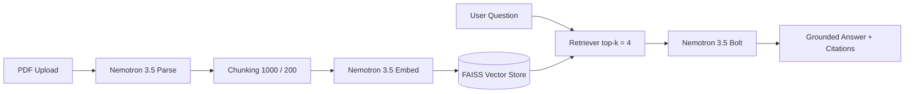

# TalkToPDFs

**Chat with your PDF documents using a retrieval-augmented generation (RAG) pipeline powered by NVIDIA Nemotron.**

[](https://www.python.org/)
[](https://streamlit.io/)
[](https://python.langchain.com/)
[](https://build.nvidia.com/)
[](LICENSE)

TalkToPDFs is a Streamlit application that turns static PDFs into an interactive knowledge base. Upload one or more documents, and ask questions in natural language. Answers are grounded strictly in the retrieved document content and cite the source file and page.

---

## Table of Contents

- [Features](#features)
- [How It Works](#how-it-works)
- [Tech Stack](#tech-stack)
- [Prerequisites](#prerequisites)
- [Quick Start](#quick-start)
- [Configuration](#configuration)
- [Usage](#usage)
- [Project Structure](#project-structure)
- [Customization](#customization)
- [Troubleshooting](#troubleshooting)
- [Security](#security)
- [Contributing](#contributing)
- [License](#license)
- [Acknowledgements](#acknowledgements)

---

## Features

- **Multi-document Q&A** — Upload and query across several PDFs at once.
- **High-fidelity parsing** — NVIDIA Nemotron Parse extracts text from complex layouts, tables, and scanned pages via OCR.
- **Grounded answers** — Responses are limited to retrieved context, with source file and page citations.
- **Conversational memory** — The assistant uses the last six turns of chat history for follow-up questions.
- **Resilient ingestion** — Falls back to PyPDF2 extraction if Nemotron parsing returns no content.
- **Clean chat interface** — A modern, monochrome chat UI with progress feedback and document management.

---

## How It Works



1. Each PDF page is rendered to an image and parsed into text and structure by Nemotron Parse.
2. Parsed text is split into overlapping chunks (1000 characters, 200 overlap).
3. Chunks are embedded with Nemotron Embed and indexed in a local FAISS vector store.
4. A question retrieves the four most similar chunks, which are passed to Nemotron Bolt as context.
5. The model answers using only that context and reports the source document and page.

---

## Tech Stack

| Layer | Technology |
| --- | --- |
| User Interface | Streamlit |
| RAG Orchestration | LangChain |
| Document Parsing | NVIDIA Nemotron 3.5 Parse (PyPDF2 fallback) |
| Embeddings | NVIDIA Nemotron 3.5 Embed |
| Vector Store | FAISS |
| Language Model | NVIDIA Nemotron 3.5 Bolt |
| PDF Rendering | PyMuPDF |

---

## Prerequisites

- **Python 3.12** or later
- An **NVIDIA API key** from [build.nvidia.com](https://build.nvidia.com/)

---

## Quick Start

```bash
# Clone the repository
git clone https://github.com/cnitin041/Talktopdfs.git
cd Talktopdfs

# Create and activate a virtual environment
python -m venv .venv

# Windows
.venv\Scripts\activate

# macOS / Linux
source .venv/bin/activate

# Install dependencies
pip install -r requirements.txt
```

Create a `.env` file in the project root:

```bash
NVIDIA_API_KEY=nvapi-your-key-here
```

Launch the application:

```bash
streamlit run app.py
```

The app opens at `http://localhost:8501`.

---

## Configuration

| Variable | Required | Description |
| --- | --- | --- |
| `NVIDIA_API_KEY` | Yes | Used for PDF parsing, embeddings, and answer generation. Read from `.env`, environment variables, or Streamlit secrets. |

As an alternative to `.env`, you can use `.streamlit/secrets.toml`:

```toml
NVIDIA_API_KEY = "nvapi-your-key-here"
```

Model and endpoint constants are defined at the top of `app.py`:

| Component | Value |
| --- | --- |
| Parser | `nvidia/nemotron-3.5-parse` |
| Embeddings | `nvidia/nemotron-3.5-embed-1b` |
| Generation | `nvidia/nemotron-3.5-bolt-e4b` |

---

## Usage

1. Open the sidebar and upload one or more PDF files.
2. Click **Process documents** and wait for parsing and indexing to finish.
3. Ask a question in the composer at the bottom of the chat.
4. Use **New chat** to start a fresh conversation without re-uploading documents.
5. Use **Settings → Clear documents** to reset the knowledge base.

---

## Project Structure

```text
Talktopdfs/
├── app.py                  # Application: UI, ingestion, retrieval, generation
├── requirements.txt        # Python dependencies
├── .streamlit/
│   └── config.toml         # Theme and client configuration
├── .env                    # Local secrets (not committed)
├── LICENSE
└── README.md
```

---

## Customization

| Setting | Location | Default |
| --- | --- | --- |
| Chunk size / overlap | `get_text_chunks` in `app.py` | `1000` / `200` |
| Retrieved chunks (`k`) | `get_conversation_chain` in `app.py` | `4` |
| Generation temperature | `ChatNVIDIA(...)` in `app.py` | `0.3` |
| Max parse output tokens | `PARSE_MAX_OUTPUT_TOKENS` in `app.py` | `9000` |
| Chat history window | `run_chain` in `app.py` | last `6` turns |

---

## Troubleshooting

| Issue | Resolution |
| --- | --- |
| `NVIDIA_API_KEY is missing` | Add the key to `.env` or `.streamlit/secrets.toml`. |
| `No text could be extracted` | The PDF may be image-only or the parse request failed. Verify the API key and quota. |
| `page(s) reached the parse output limit` | Increase `PARSE_MAX_OUTPUT_TOKENS` in `app.py`. |
| HTTP `429` or `5xx` responses | The parser retries with exponential backoff; reduce batch size if limits persist. |
| Password-protected PDFs | These are skipped automatically. Remove the password before uploading. |

---

## Security

- Never commit `.env` or `.streamlit/secrets.toml`; both are intended to stay local.
- The API key is used server-side only and is not exposed to the browser.
- Answers are grounded in uploaded content, but always verify critical information against the source documents.

---

## Contributing

Contributions are welcome. To propose a change:

1. Fork the repository.
2. Create a feature branch: `git checkout -b feature/your-feature`.
3. Commit your changes with a clear message.
4. Open a pull request describing the motivation and scope.

For bugs or feature requests, please open an issue.

---

## License

Released under the [Apache License 2.0](LICENSE).

---

## Acknowledgements

- [NVIDIA Build](https://build.nvidia.com/) — Nemotron parsing, embeddings, and generation
- [LangChain](https://python.langchain.com/) — RAG orchestration
- [Streamlit](https://streamlit.io/) — Application framework
- [FAISS](https://github.com/facebookresearch/faiss) — Vector similarity search
- [PyMuPDF](https://pymupdf.readthedocs.io/) — PDF rendering
